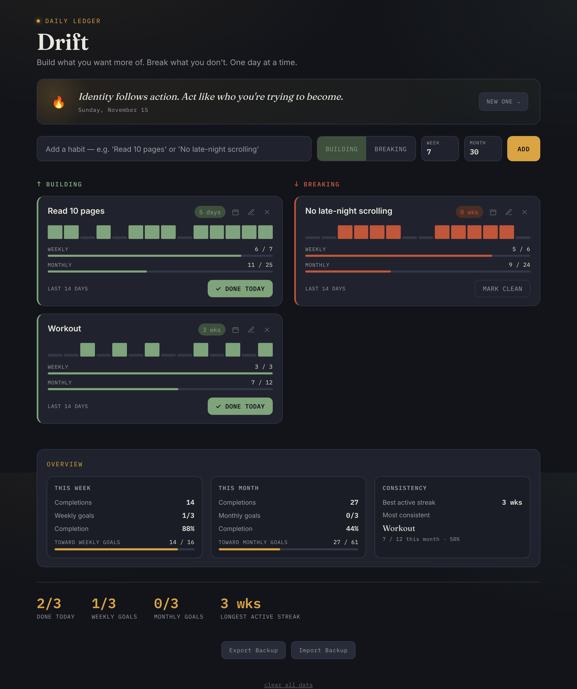
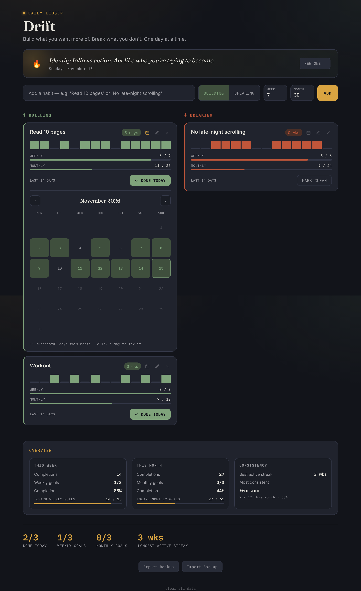
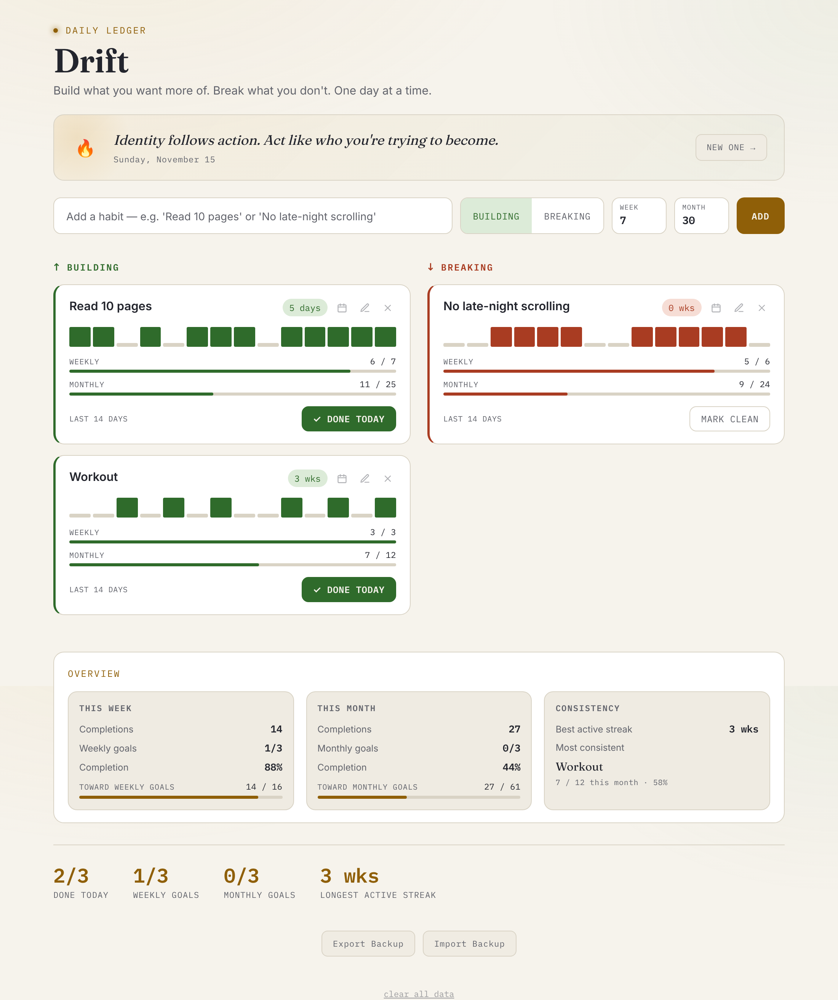

# Drift — Habit Tracker

## Overview

Drift is a responsive personal habit tracker built with vanilla HTML, CSS, and JavaScript. It helps you track habits you want to build and habits you want to break, with weekly and monthly goals, streaks, and a clear daily workflow — all stored privately in your browser.

## Live Demo

[View Drift on GitHub Pages](https://santiagosimon1999-wq.github.io/drift-habit-tracker/)

## Features

- Building and Breaking habit categories
- Daily completion tracking (Mark Done / Mark Clean)
- Weekly goals (1–7 successful days)
- Monthly goals (1–31 successful days)
- Weekly and monthly progress bars
- Streaks that respect your goals: day streaks for daily habits, week streaks for habits with a lighter weekly goal
- Click any past day in the history calendar to fix a missed log
- 14-day activity visualization
- Monthly habit calendar / history view
- Weekly / monthly overview dashboard
- Inline habit editing
- Motivational messages
- Persistent `localStorage` data
- JSON backup export
- JSON backup import
- Responsive layout for desktop and mobile
- Installable PWA that works offline
- Reorder, pause or archive habits without losing their history
- Optional notes for any day (autosaved, marked on the calendar)
- Daily reminder notification (while Drift is open or installed)
- Configurable first day of the week (Monday or Sunday)
- Light / dark theme: follows your system, or pick one with the footer button
- Keyboard- and screen-reader-friendly (labelled progress bars, accessible dialogs)

## Screenshots





## Tech Stack

- HTML5
- CSS3
- Vanilla JavaScript
- Web Storage / localStorage
- Service Worker + Web App Manifest (PWA)
- Node's built-in test runner (`node --test`)
- Git
- GitHub
- GitHub Pages

## How It Works

- Each habit is a JavaScript object with a name, type (`good` / `bad`), goals, creation date, and a `log` of completed days.
- Daily completions are stored by **local** calendar date (`YYYY-MM-DD`), not UTC.
- Weekly and monthly progress are calculated from that history and each habit’s configured goals.
- App state is saved under the `drift-habits` key in `localStorage`.
- Backups are plain JSON files you can download and re-import.

## Running Locally

```bash
git clone https://github.com/santiagosimon1999-wq/drift-habit-tracker.git
cd drift-habit-tracker
python3 -m http.server 8000
```

Then open [http://localhost:8000](http://localhost:8000) in your browser.

Run the tests with `npm test` (Node 20+). Unit tests (streaks, goals, backup parsing) need no dependencies; UI tests use Playwright (`npm install && npx playwright install chromium`) and are skipped if it isn't installed.

The app is installable and works offline once loaded over HTTP(S) (the service worker is skipped on `file://`). You can also open `index.html` directly, but a local server is recommended so file-based features (like import) behave consistently.

## Data & Privacy

- Habit data stays in your browser’s `localStorage` under the key `drift-habits`.
- There are no accounts and no cloud database in this version.
- You can export a JSON backup at any time and import it later on the same or another browser.

## What I Learned

Building Drift was practice in structuring a small app without a framework:

- DOM manipulation and event handling
- Managing application state with vanilla JavaScript
- Persisting data with `localStorage`
- Local date-based calculations (weeks starting Monday, month boundaries)
- Validating user input and backup files safely
- Designing a responsive UI with CSS
- Using Git and GitHub, including deployment with GitHub Pages

## Future Improvements

- Optional cloud sync
- Installable PWA
- Editing historical calendar entries
- Additional analytics views
